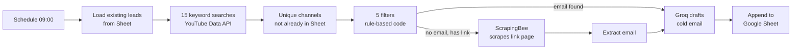

# YouTube Lead Generation (n8n)

An n8n workflow that finds YouTube creators who could use professional video editing, filters them with five rule-based checks, finds a contact email, and drafts a personalised cold email for each with an LLM. Results land in Google Sheets for the outreach team.

Built as a freelance project for a video-editing agency. **WF1 (Channel Discovery) is shipped and used by the client.** WF2 to WF4 (sending, reply alerts, orchestration) were designed; the client chose to run outreach in-house.

## What a run does

| | |
|---|---|
| Schedule | Once a day, 09:00 |
| Search volume | 15 searches (5 niches x 3 keywords), up to 50 recent videos each: up to 750 results |
| Output | 4 to 7 qualified leads per run, each with a drafted cold email |
| Run time | 15 to 20 minutes |
| Storage | Google Sheets (status `New`) |

## How it works

1. **Deduplicate first.** Existing leads are read from the sheet so a channel is never added twice.
2. **Search.** 5 niches (Real Estate, Finance, Business, AI, Law), 3 keywords each, videos from the last 7 days.
3. **Filter**, in this order (cheapest checks first, so fewer API calls are spent on channels that fail):
   1. Subscribers between 5K and 1M
   2. Uploaded within the last 14 days
   3. Region not in the client's excluded list (YouTube's country field, else a keyword guess from the description)
   4. Average views on recent videos between 5% and 50% of subscribers
   5. Has a contact email (channel description, branding, or recent video descriptions)
4. **Email fallback.** No email but an external link (Linktree, Instagram, etc.)? The link page is scraped with ScrapingBee and the first valid email is used. Common false matches (tracking and platform addresses) are filtered out.
5. **Draft.** Groq (`llama-3.3-70b-versatile`) writes a 60 to 80 word email.

## Design decisions

- **Rules for filtering, LLM only for writing.** Subscriber counts, dates and ratios are exact, free and explainable in code: every skipped channel is logged with its reason. The LLM is used only where language is needed.
- **Prompt designed not to sound AI-written.** A fixed persona and structure, a word limit, a list of banned cliche openers ("I came across", "I hope this finds you"), and no em dashes or curly quotes.
- **One bad channel never stops a run.** Each channel is processed in its own error handler. If the LLM call fails, the lead is still saved with an error note in the draft column.
- **API quota failover.** On a 403/quota error the YouTube calls retry with a second key. (The cleaner long-term fix is a quota increase from Google.)

## Known limitations

- The region guess uses substring matching, so it can misfire (for example "Indiana" contains "india"). Better: whole-word matching, YouTube language fields, and a "needs review" status for unclear cases.
- The LLM draft isn't validated after generation (length, subject line); a check plus one retry would catch bad drafts.
- Google Sheets is fine at this volume; at larger scale this would move to a database.

## Setup

1. Import `wf1-channel-discovery.json` into n8n.
2. Replace the placeholders: `YOUR_YOUTUBE_API_KEY`, `YOUR_GROQ_API_KEY`, `YOUR_SCRAPINGBEE_API_KEY`, `YOUR_GOOGLE_SHEET_ID`, and connect your Google Sheets credential.
3. Better: move the keys into n8n Credentials or environment variables instead of node fields.

## Tech

n8n · YouTube Data API v3 · Groq (Llama 3.3 70B) · ScrapingBee · Google Sheets · JavaScript (n8n Code nodes)
